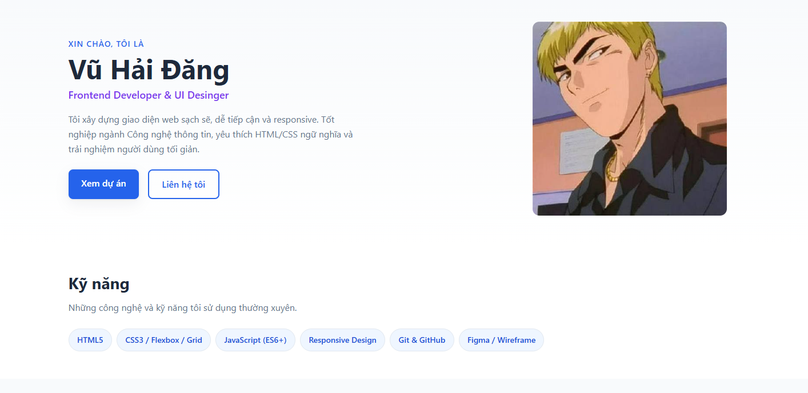
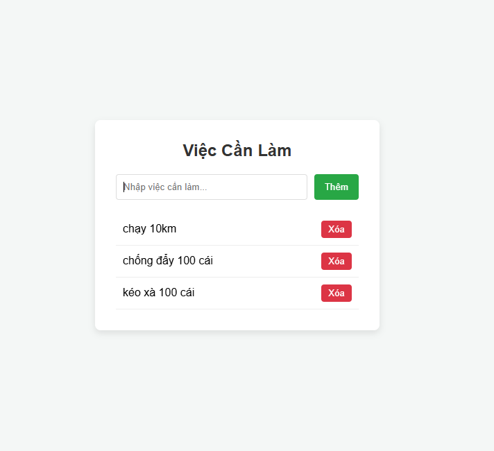
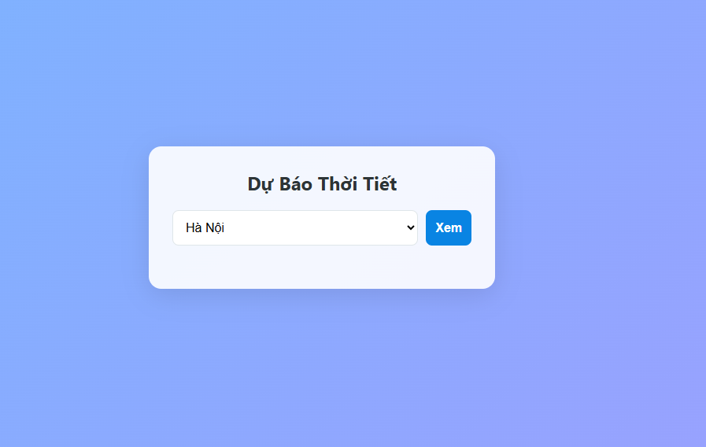
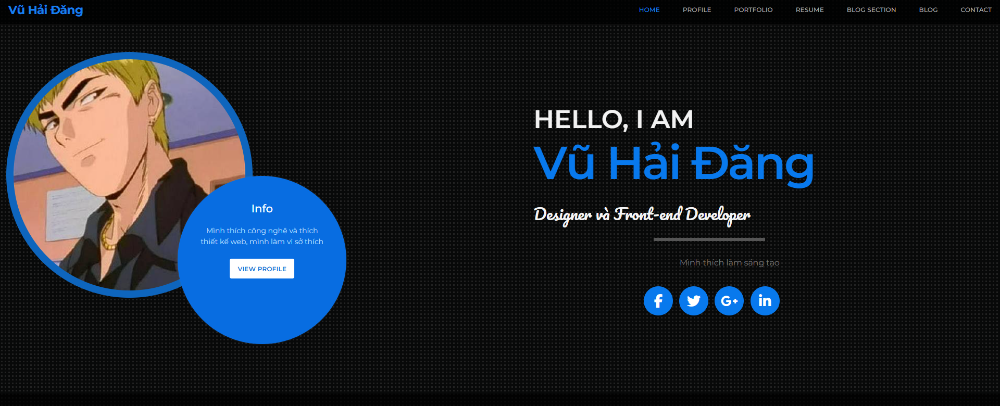

# Website Portfolio - Vũ Hải Đăng

## 1. Giới thiệu

>Dự án học tập xây dựng bằng HTML, CSS và JavaScript thuần. Sản phẩm hướng đến người xem muốn tìm hiểu thông tin cá nhân, kỹ năng và một số giao diện web mẫu của Vũ Hải Đăng; đồng thời dùng để thực hành bố cục và thiết kế responsive.

## 2. Chức năng chính

- Trang portfolio tại `index.html`: giới thiệu cá nhân, kỹ năng, dự án và thông tin liên hệ.
- Trang Todo tại `project/todo.html`: thêm công việc, đánh dấu hoàn thành, xóa công việc và thêm bằng phím Enter. Dữ liệu chỉ tồn tại trong phiên trang hiện tại.
- Trang thời tiết tại `project/weather.html`: có giao diện nhập thành phố và khu vực hiển thị thời tiết. Chức năng lấy dữ liệu hiện chưa hoạt động ổn định do URL API trong mã nguồn đang được tạo sai.
- Trang mẫu blog/profile tại `project/blog.html`: giao diện tĩnh, một số liên kết vẫn là nội dung giữ chỗ.
- Trang thực hành Flexbox tại `flex.html` và media query tại `responsive.html`.
- Form liên hệ trên portfolio mới là giao diện; chưa kết nối dịch vụ gửi biểu mẫu.

## 3. Công nghệ sử dụng

- HTML5.
- CSS3: Flexbox, Grid, media query và hiệu ứng CSS.
- JavaScript thuần cho tương tác Todo và phần thử nghiệm gọi dữ liệu thời tiết.
- Google Fonts và Font Awesome được tham chiếu bên ngoài trong trang `project/blog.html`.
- Không sử dụng framework frontend, backend hoặc database.

## 4. Yêu cầu môi trường

- Trình duyệt hiện đại có hỗ trợ HTML5, CSS3 và JavaScript.
- Không yêu cầu cài Node.js, database hay dịch vụ backend.
- Có thể mở `index.html` trực tiếp. Để các đường dẫn bắt đầu bằng `/assets/` trong trang blog hoạt động đúng, nên chạy máy chủ tĩnh từ thư mục gốc dự án.
- Kết nối Internet chỉ cần thiết nếu muốn tải Google Fonts, Font Awesome hoặc thử gọi dịch vụ thời tiết.

## 5. Cài đặt và cấu hình

1. Tải hoặc clone thư mục dự án về máy.
2. Không cần cài dependencies và không có tệp cấu hình môi trường `.env`.
3. Nếu đã cài Python 3, mở terminal tại thư mục dự án và chạy:

	```bash
	python -m http.server 8000
	```

Không có mật khẩu, API key hay thông tin bí mật cần cấu hình.

## 6. Chạy thử

Sau khi chạy máy chủ tĩnh ở bước trên, mở:

- Portfolio: <http://localhost:8000/>
- Flexbox: <http://localhost:8000/flex.html>
- Responsive: <http://localhost:8000/responsive.html>
- Blog/profile: <http://localhost:8000/project/blog.html>
- Todo: <http://localhost:8000/project/todo.html>
- Thời tiết: <http://localhost:8000/project/weather.html>

Có thể dừng máy chủ bằng `Ctrl+C` trong terminal.

## 7. Tài khoản demo

Không có tài khoản đăng nhập hoặc tài khoản demo. Các trang hiện truy cập trực tiếp, không yêu cầu xác thực.

## 8. Ảnh minh chứng và liên kết demo

Các ảnh đang dùng trong phần dự án của portfolio:

- Landing page: 
- Todo: 
- Thời tiết: 
- Blog: 

Chưa có URL demo được triển khai công khai. Chạy local theo mục 6 để xem sản phẩm. Trang portfolio hiện liên kết đến [GitHub cá nhân](https://github.com/ccla123213); URL repository riêng chưa được cung cấp.

## 9. Hạn chế và hướng phát triển

- Todo chưa lưu dữ liệu sau khi tải lại trang và cần xử lý nội dung người dùng an toàn hơn.
- Trang thời tiết cần sửa URL gọi dịch vụ và kiểm tra phản hồi/lỗi mạng trước khi có thể dùng thực tế.
- Form liên hệ chưa gửi hoặc lưu thông tin; các liên kết dự án và một số liên kết trên trang blog vẫn là placeholder.
- Nội dung blog/profile còn văn bản mẫu, chưa đồng nhất với thông tin portfolio.
- Có thể phát triển tiếp bằng cách hoàn thiện các tương tác, lưu trữ dữ liệu phù hợp, bổ sung nội dung thật và triển khai lên dịch vụ hosting tĩnh.

## 10. Thông tin nhóm thực hiện

- Tên hiển thị trong sản phẩm: Vũ Hải Đăng.
- Vai trò nhóm và danh sách thành viên khác: chưa được cung cấp trong mã nguồn hiện tại.
