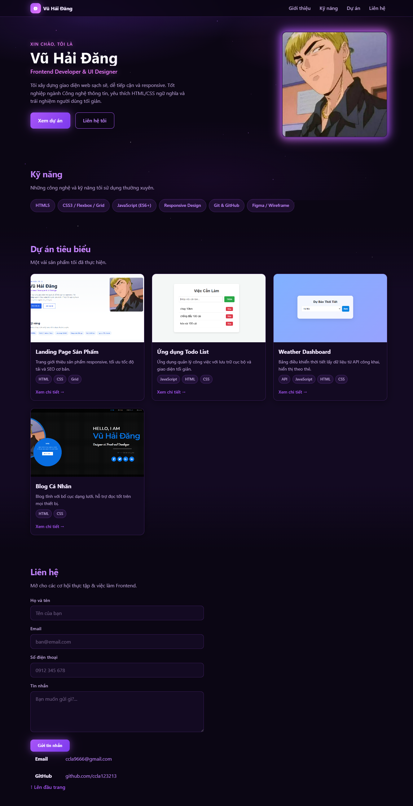
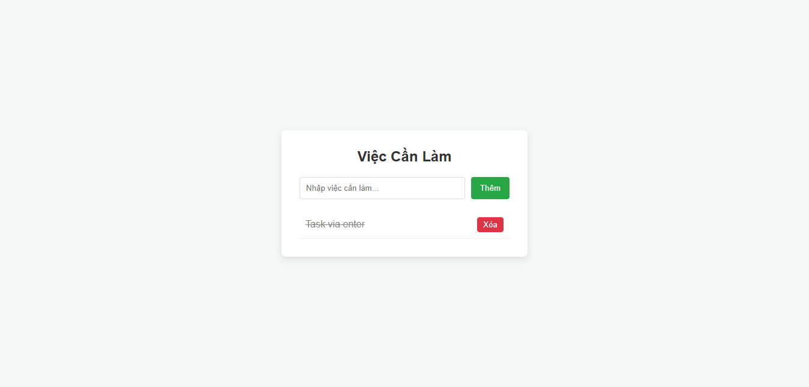
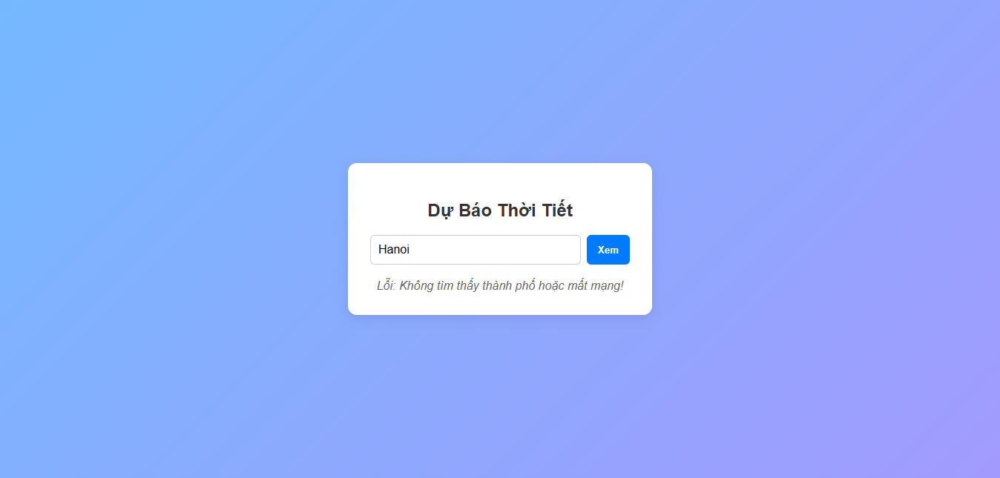

# Báo cáo kiểm thử và minh chứng

- Ngày kiểm thử: 2026-10-27.
- Phiên bản tham chiếu: v0.1.0, xem [CHANGELOG](../CHANGELOG.md).
- Môi trường: trình duyệt tích hợp VS Code, mở các trang từ tệp local.

## Ảnh giao diện

Ảnh được chụp từ giao diện thực tế trong quá trình kiểm thử:







## Kết quả kiểm thử

| Chức năng | Kiểm tra | Kết quả |
| --- | --- | --- |
| Portfolio | Mở trang, kiểm tra điều hướng và các khu vực giới thiệu, kỹ năng, dự án, liên hệ | Đạt |
| Todo | Bỏ qua mục rỗng; thêm bằng nút; thêm bằng Enter; đánh dấu hoàn thành; xóa mục | Đạt, cả 5 thao tác |
| Thời tiết | Tải dữ liệu mặc định cho Hanoi | Chưa đạt; request lỗi `ERR_NAME_NOT_RESOLVED` do URL API được tạo sai trong mã nguồn |
| Form liên hệ | Chưa kiểm thử gửi dữ liệu; hiện chỉ có giao diện và chưa kết nối dịch vụ xử lý | Chưa triển khai |

## Mã nguồn và demo

- GitHub: [hồ sơ ccla123213](https://github.com/ccla123213). URL repository cụ thể chưa được xác định trong workspace.
- Demo trực tuyến: chưa triển khai; không có URL demo công khai.

## Chạy thử cục bộ

1. Cài Python 3 hoặc mở terminal tại thư mục gốc website.
2. Chạy máy chủ tĩnh:

	```bash
	python -m http.server 8000
	```

3. Mở portfolio tại <http://localhost:8000/>. Các trang khác:
	- Todo: <http://localhost:8000/project/todo.html>
	- Thời tiết: <http://localhost:8000/project/weather.html>
	- Blog/profile: <http://localhost:8000/project/blog.html>
	- Flexbox: <http://localhost:8000/flex.html>
	- Responsive: <http://localhost:8000/responsive.html>

Đây là địa chỉ local chỉ dùng sau khi chạy máy chủ trên máy cá nhân, không phải demo trực tuyến. Dừng máy chủ bằng `Ctrl+C`.

## Release note và hạn chế

Release note bàn giao nằm trong [CHANGELOG.md](../CHANGELOG.md). Các hạn chế đã xác nhận: chức năng thời tiết chưa lấy được dữ liệu; form liên hệ chưa gửi dữ liệu; Todo không lưu công việc sau khi tải lại trang; một số liên kết dự án vẫn là placeholder.
